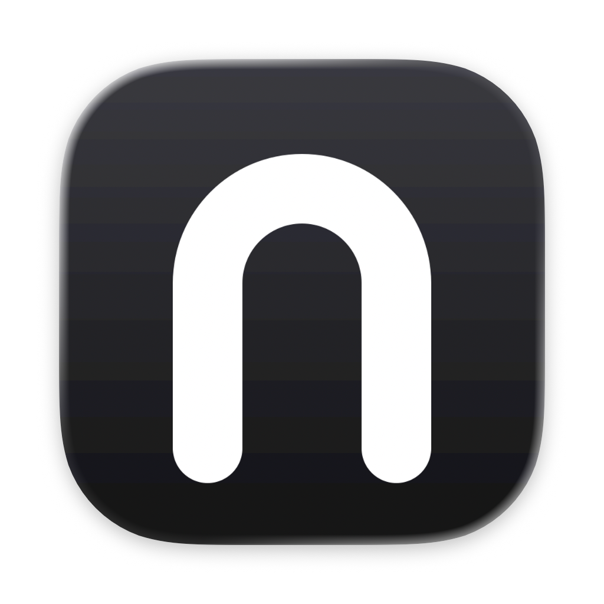

<p align="center"></p>

# Niche

Niche brings the Dynamic Island to the MacBook notch, a lot like [Alcove](https://tryalcove.com/) does.

The difference is that Niche stays minimal on purpose. Instead of shipping a fixed set of features, it gives you an API to plug your own apps and scripts into the notch. The API is modelled on Apple's [Live Activities](https://developer.apple.com/design/human-interface-guidelines/live-activities), so if you know ActivityKit, you already know how it works.

## Requirements

- A Mac with a notch
- macOS 14 or later
- Xcode

## Install Niche

1. Install the app and the `niche` command.

   ```sh
   make install
   ```

2. Start the app.

   ```sh
   make run
   ```

## Example

1. Show an activity.

   ```sh
   niche request --id build --compactLeading "symbol:hammer.fill;foregroundStyle=orange" --compactTrailing "text:3/10"
   ```

2. Change the activity.

   ```sh
   niche update build --compactTrailing "text:4/10"
   ```

3. Remove the activity.

   ```sh
   niche end build
   ```

[`Integrations/spotify.py`](Integrations/spotify.py) is a full example. It shows a Spotify player with the cover, the controls, and a seek bar.
